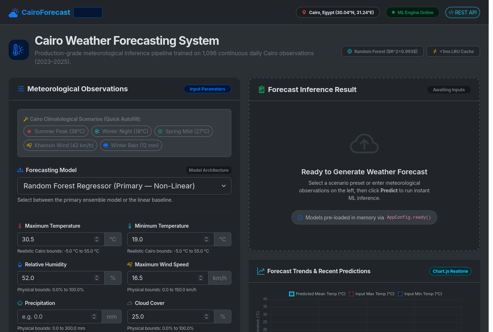
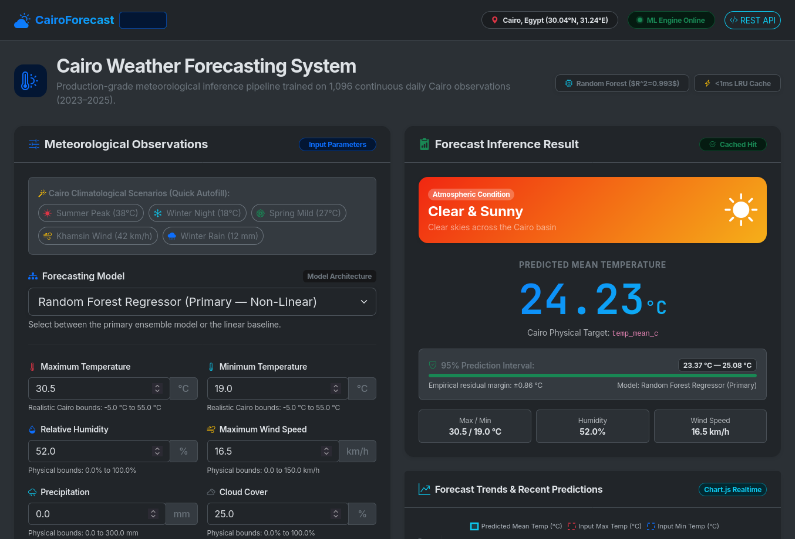
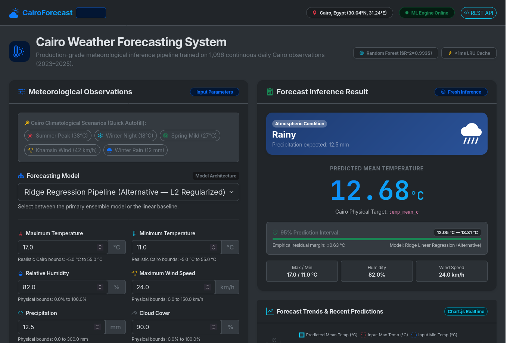
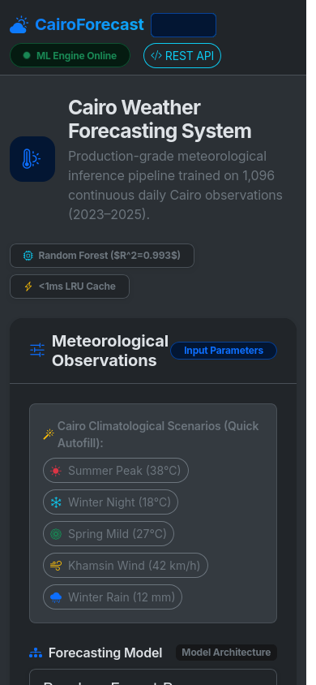

# Weather Forecasting — Foundation Phase (Week 4)

> [!IMPORTANT]
> ### 📌 Primary Deliverables & Key Artifacts
> - **Executive Summary Report:** [`artifacts/executive_summary.md`](artifacts/executive_summary.md) — Concise analytical report covering climate context, API parameters, ADF and KPSS stationarity diagnostics, seasonal dynamics, and modeling guidance.
> - **Visual EDA Gallery:** [`artifacts/figures/`](artifacts/figures/) — 9 publication-grade visualizations (150 DPI) spanning time-series dynamics, rolling windows, classical additive decomposition (statsmodels seasonal_decompose, period=365), ACF/PACF, correlation, and rolling Z-score anomaly detection.
> - **Preprocessed Time-Series Dataset:** [`data/processed/cairo_weather_clean.csv`](data/processed/cairo_weather_clean.csv) — 1,096 continuous daily observations (2023–2025) across 7 cleaned, unscaled variables in physical units (zero missing values, validated bounds).
> - **Interactive Evaluation Notebook:** [`notebooks/main_pipeline.ipynb`](notebooks/main_pipeline.ipynb) — Executable Jupyter notebook providing step-by-step walkthrough of Parts 1, 2, and 3 with inline plots and analysis.
> - **Production Django Deployment (Task 6):** [Task 6 Section](#-task-6-deploying-the-weather-prediction-model-with-django) — Production-grade web interface and REST API (`/api/predict/`) with Bootstrap 5 UI, thread-safe ML singleton loader, Chart.js trends, and in-memory LRU caching.

---

End-to-end weather forecasting ML system: data acquisition, time-series structuring, and deep exploratory data analysis.

## 📍 Project Scope

| Detail          | Value                                       |
|----------------|---------------------------------------------|
| **Location**   | Cairo, Egypt (30.0444°N, 31.2357°E)         |
| **Period**     | 2023-01-01 → 2025-12-31 (3 years, 1,096 daily records) |
| **Splits**     | Train = 731 rows (2023–2024, leap year), Test = 365 rows (2025) |
| **Missingness**| 0 nulls in raw API response; imputation logic is defensive and unexercised |
| **API**        | Open-Meteo Historical Weather Archive       |
| **Variables**  | 7 daily features (cleaned, unscaled variables in physical units) |

## 🚀 Quickstart & Environment Setup

This project uses [`uv`](https://github.com/astral-sh/uv) for fast, deterministic, and modern Python package and environment management.

```bash
# 1. Install uv (if not already installed)
curl -LsSf https://astral.sh/uv/install.sh | sh

# 2. Create virtual environment and install dependencies
uv venv
source .venv/bin/activate  # On Linux/macOS (.venv\Scripts\activate on Windows)
uv pip install -r requirements.txt

# 3. (Optional) Configure environment overrides
cp .env.example .env

# 4. Run the full pipeline (Acquisition → Preparation → EDA)
# Default mode: fetches fresh data from Open-Meteo API and regenerates all artifacts
uv run run_pipeline.py

# Offline / Cached mode: reuses existing raw JSON & clean CSV (skips network calls, preserves bitwise hashes)
uv run run_pipeline.py --use-cached
```

### Execution Modes & Reproducibility
- **Default (Fresh Regeneration):** Running `uv run run_pipeline.py` contacts the Open-Meteo API, downloads fresh observations, executes data cleaning, and updates raw and processed files. Because Open-Meteo returns dynamic server-side header fields (`generationtime_ms`), a fresh API query produces a different JSON payload hash while retaining identical numerical records.
- **Cached Reproducibility (`--use-cached`):** Running with `--use-cached` (or setting `WEATHER_USE_CACHED=true` in `.env`) reuses local cached files under `data/raw/` and `data/processed/` with clear log confirmation, ensuring zero network latency and bitwise identical SHA-256 hashes across consecutive runs.
- **Force Fresh (`--force`):** Forces fresh API retrieval and file overwrite even if `WEATHER_USE_CACHED=true` is set.

## 📁 Project Structure

```
weather-forecasting/
├── config.py                          # Centralized configuration (location, paths, bounds)
├── run_pipeline.py                    # Single orchestration entry point
├── requirements.txt                   # Project dependencies (pinned minimums)
├── .env.example                       # Template for environment configuration overrides
├── .env                               # Local environment overrides
├── .gitignore                         # Git exclusion rules (.venv, pycache, OS files)
├── README.md                          # Project documentation and quickstart
├── src/
│   ├── __init__.py
│   ├── data_acquisition.py            # Part 1: API fetch & raw JSON persistence
│   ├── data_preparation.py            # Part 2: Parsing, cleaning, validation & CSV export
│   └── eda.py                         # Part 3: Deep time-series EDA & statistical tests
├── data/
│   ├── raw/
│   │   └── open_meteo_response.json   # Raw API response payload (107 KB)
│   └── processed/
│       └── cairo_weather_clean.csv    # Validated, cleaned dataset (1,096 rows × 7 features)
├── artifacts/
│   ├── figures/                       # Publication-grade figures (PNG, 150 DPI)
│   │   ├── 01_distributions.png
│   │   ├── 02_temporal_lines.png
│   │   ├── 03_rolling_means.png
│   │   ├── 04_monthly_boxplots.png
│   │   ├── 05_volatility.png
│   │   ├── 06_seasonal_decomposition.png
│   │   ├── 07_acf_pacf.png
│   │   ├── 08_correlation_heatmap.png
│   │   └── 09_rolling_zscore_outliers.png
│   └── executive_summary.md           # ~0.5-page executive summary answering required questions
└── notebooks/
    └── main_pipeline.ipynb            # Interactive walkthrough notebook for evaluation
```

## 📊 Features Collected

| Variable         | API Parameter                | Unit  | Description |
|------------------|------------------------------|-------|-------------|
| Max Temperature  | `temperature_2m_max`         | °C    | Maximum daily air temperature at 2m |
| Min Temperature  | `temperature_2m_min`         | °C    | Minimum daily air temperature at 2m |
| Mean Temperature | `temperature_2m_mean`        | °C    | Mean daily air temperature at 2m |
| Precipitation    | `precipitation_sum`          | mm    | Daily precipitation sum |
| Humidity         | `relative_humidity_2m_mean`  | %     | Mean relative humidity at 2m |
| Wind Speed       | `wind_speed_10m_max`         | km/h  | Maximum wind speed at 10m |
| Cloud Cover      | `cloud_cover_mean`           | %     | Mean cloud cover percentage |

## 📈 EDA Visualizations & Statistical Tests

The pipeline generates 9 publication-grade figures under `artifacts/figures/`:
1. **Feature Distributions** (`01_distributions.png`) — Histograms with kernel density estimates (KDE) across all variables.
2. **Temporal Dynamics** (`02_temporal_lines.png`) — Full 3-year timeline for daily temperatures (min, max, mean envelope) and precipitation bars.
3. **Rolling Trend Analysis** (`03_rolling_means.png`) — 7-day and 30-day moving averages smoothing seasonal trajectories.
4. **Monthly Seasonality** (`04_monthly_boxplots.png`) — Monthly distributions illustrating seasonal cycles and intra-month dispersion.
5. **Temperature Volatility** (`05_volatility.png`) — 30-day rolling standard deviations identifying seasonal transition variance.
6. **Seasonal Decomposition** (`06_seasonal_decomposition.png`) — Classical additive decomposition (statsmodels seasonal_decompose, period=365) into Trend, Annual Seasonal, and Residual.
7. **Autocorrelation & Partial Autocorrelation** (`07_acf_pacf.png`) — ACF and PACF plots up to 60 lags diagnosing persistence and autoregressive structure.
8. **Correlation Matrix** (`08_correlation_heatmap.png`) — Triangular Pearson correlation matrix evaluating inter-variable colinearity.
9. **Contextual Outlier Detection** (`09_rolling_zscore_outliers.png`) — Rolling 30-day Z-scores (|Z| > 3.0) isolating true anomalies (e.g. 2025-04-22 heat spike at 34.1°C, Z = +3.05, consistent with a Khamsin-type event; not externally verified).

### Statistical Stationarity (ADF & KPSS Tests)
- **Mean Temperature:**
  - **Raw Series:** ADF stat = `-2.0139` ($p = 0.2805$); KPSS stat = `0.2351` ($p = 0.1000$). ADF fails to reject while KPSS does not reject stationarity on the raw series, indicating inconclusive, seasonality-driven non-stationarity rather than a clear unit root.
  - **First Difference ($d=1$, $N=1,095$):** ADF stat = `-15.1740` ($p < 10^{-20}$); KPSS stat = `0.1501` ($p = 0.1000$) &rarr; Confirmed stationary.
  - **Seasonal Difference ($D=1, s=365$, leaves 731 rows):** ADF stat = `-9.4576` ($p < 10^{-15}$); KPSS stat = `0.3906` ($p = 0.0812$) &rarr; Confirmed stationary.
  - **Modeling Directive:** First differencing or Fourier/calendar features are recommended over seasonal differencing at lag 365, avoiding the steep loss of 365 rows (one full year of training data).
- **Precipitation:** ADF statistic = `-30.5373`, p-value = `0.0000` &rarr; **Stationary** (zero-inflated point process, 94.0% dry days; two-stage hurdle model or Tweedie loss recommended).

## 🔧 API Details

- **Endpoint:** `https://archive-api.open-meteo.com/v1/archive`
- **Authentication:** None required (free, keyless)
- **Rate Limit:** 10,000 requests/day
- **Data Source:** ECMWF ERA5 Reanalysis
- **License:** CC BY 4.0

## 🔮 Task 5 — Forecasting

This phase builds time-series preprocessing pipelines, statistical baselines, SARIMAX models, and deep learning architectures (Simple RNN & Stacked LSTM) for multi-step and one-step ahead temperature forecasting.

- **Main Deliverable Notebook:** [`notebooks/task5_forecasting.ipynb`](notebooks/task5_forecasting.ipynb)
- **Engineered Features Dataset:** [`data/processed/cairo_weather_features.csv`](data/processed/cairo_weather_features.csv)
- **Task 5 Generated Figures:** [`artifacts/task5/figures/`](artifacts/task5/figures/)
  - [`outliers_rolling.png`](artifacts/task5/figures/outliers_rolling.png) — Trailing 30-day rolling Z-score detection & winsorization
  - [`acf_after_differencing.png`](artifacts/task5/figures/acf_after_differencing.png) — ACF curves across differencing transformations
  - [`acf_pacf.png`](artifacts/task5/figures/acf_pacf.png) — ACF/PACF on first difference for order identification
  - [`sarima_forecast.png`](artifacts/task5/figures/sarima_forecast.png) — 21-day SARIMA forecast with 95% confidence intervals vs actual
  - [`residuals_over_time.png`](artifacts/task5/figures/residuals_over_time.png) & [`residual_hist_qq.png`](artifacts/task5/figures/residual_hist_qq.png) — Standardized residual diagnostics
  - [`error_by_horizon.png`](artifacts/task5/figures/error_by_horizon.png) — Walk-forward error growth across forecast horizons $h = 1 \dots 21$
  - [`lstm_loss.png`](artifacts/task5/figures/lstm_loss.png) — Training and validation loss curves with EarlyStopping
  - [`model_comparison.png`](artifacts/task5/figures/model_comparison.png) — MAE and RMSE performance comparison across all models

### Model Comparison Results (Held-Out 21-Day Test Set: Dec 11–31, 2025)

#### Protocol A (21-Step Recursive Out-of-Sample Horizon)
| Model | MAE (°C) | RMSE (°C) | MAPE (%) | sMAPE (%) | Notes |
| :--- | :---: | :---: | :---: | :---: | :--- |
| **ARIMA (non-seasonal)** | 1.243 | 1.424 | 7.65 | 7.29 | Order (1, 1, 3) |
| **SARIMA ($m=7$)** | 1.243 | 1.424 | 7.65 | 7.29 | Equals ARIMA(1, 1, 3); `auto_arima` selected $(0, 0, 0)_7$ |
| **SARIMA manual ($1,1,1)(1,0,1,7)$** | **0.655** | **0.838** | **3.97** | **3.92** | Manual reasoned order with weekly $m=7$ |
| **Simple RNN (bonus, seed 42)** | 1.220 | 1.461 | 7.30 | 7.68 | Recursive 21-step rollout (seed 42 baseline) |
| **LSTM (bonus, seed 42)** | 0.771 | 0.954 | 4.75 | 4.59 | Recursive 21-step rollout (seed 42 baseline) |
| **Persistence** | **0.657** | **0.841** | **3.98** | **3.93** | Repeats last train observation ($16.20^\circ\text{C}$) |
| **Seasonal-naive (lag 7)** | 1.810 | 2.492 | 10.92 | 10.03 | Cyclic repetition of last 7 train days |

#### Protocol B (One-Step-Ahead Daily Update)
| Model | MAE (°C) | RMSE (°C) | MAPE (%) | sMAPE (%) | Notes |
| :--- | :---: | :---: | :---: | :---: | :--- |
| **ARIMA (non-seasonal)** | 0.670 | 0.809 | 4.03 | 3.97 | Daily one-step update; order (1, 1, 3) |
| **SARIMA ($m=7$)** | 0.670 | 0.809 | 4.03 | 3.97 | Equals ARIMA(1, 1, 3); `auto_arima` selected $(0, 0, 0)_7$ |
| **SARIMA manual ($1,1,1)(1,0,1,7)$** | 0.711 | 0.846 | 4.26 | 4.23 | Manual reasoned order with weekly $m=7$ |
| **Simple RNN (bonus, seed 42)** | 0.663 | 0.816 | 3.95 | 3.96 | Daily one-step update (seed 42 baseline) |
| **LSTM (bonus, seed 42)** | **0.594** | **0.747** | **3.58** | **3.55** | Best overall 1-step predictor (seed 42 baseline) |
| **Persistence** | 0.686 | 0.819 | 4.12 | 4.09 | Previous day's actual observation |
| **Seasonal-naive (lag 7)** | 1.357 | 1.695 | 8.08 | 7.87 | True value at $t-7$ |

#### 5-Seed Robustness Evaluation (Bonus Deep Learning Models, Seeds 0–4)
| Model | Protocol A Mean MAE (°C) | Protocol A Mean RMSE (°C) | Protocol B Mean MAE (°C) | Protocol B Mean RMSE (°C) | Protocol B Mean MAPE (%) |
| :--- | :---: | :---: | :---: | :---: | :---: |
| **Simple RNN (bonus)** | 1.667 ± 0.616 | 1.945 ± 0.671 | 0.696 ± 0.044 | 0.839 ± 0.039 | 4.15 ± 0.26% |
| **Stacked LSTM (bonus)** | 0.719 ± 0.174 | 0.894 ± 0.173 | **0.587 ± 0.012** | **0.737 ± 0.010** | **3.54 ± 0.08%** |

#### 5-Fold Walk-Forward Validation (`TimeSeriesSplit`, test_size=21)
> **Note on Coverage:** The 5 walk-forward windows cover only **2025-09-18 to 2025-12-31** (autumn cooling into winter). No window covers spring or summer.

| Model | Mean MAE (°C) | Mean RMSE (°C) | Mean MAPE (%) |
| :--- | :---: | :---: | :---: |
| **ARIMA** | 2.068 ± 0.594 | 2.393 ± 0.688 | 9.83% |
| **SARIMA (auto, $m=7$)** | 2.068 ± 0.594 | 2.393 ± 0.688 | 9.83% |
| **SARIMA manual ($1,1,1)(1,0,1,7)$** | 1.794 ± 0.827 | 2.112 ± 0.919 | 8.48% |
| **Persistence** | **1.754 ± 0.776** | **2.077 ± 0.870** | **8.28%** |
| **Seasonal-naive** | 2.255 ± 0.339 | 2.744 ± 0.354 | 10.61% |

### Conclusion & Empirical Findings

1. **Persistence vs. SARIMA Models:**
   - Under **Protocol A (21-step recursive rollout)**, the auto-selected **SARIMA ($m=7$, which equals ARIMA(1,1,3)) is worse than persistence** (MAE **1.243°C** vs. **0.657°C**; RMSE **1.424°C** vs. **0.841°C**). While the **manual SARIMA (1,1,1)(1,0,1,7)** achieved **0.655°C** MAE vs. **0.657°C** for Persistence, it has worse training AIC (**3779.63** vs. **3689.18**) than the auto-selected model, is reported as an additional row only, and its tie with persistence in Protocol A should not be over-interpreted (in walk-forward it trails persistence: **1.794°C** vs. **1.754°C** MAE).
   - In **5-fold walk-forward validation** (`TimeSeriesSplit`, test_size=21), auto-selected SARIMA (= ARIMA) achieves **2.068 ± 0.594°C** Mean MAE, while manual SARIMA achieves **1.794 ± 0.827°C** Mean MAE and Persistence achieves **1.754 ± 0.776°C** Mean MAE. Thus, auto-selected SARIMA is worse than persistence in both Protocol A and walk-forward, whereas manual SARIMA trails persistence across rolling origins.

2. **Multi-Step Forecast Dynamics & Seasonality Hypothesis:**
   - Because all differenced models use $d=1$, their multi-step forecasts do not mean-revert to an unconditional global mean; instead, they stay close to the last observed level with a small autoregressive transient/drift. When the test series remains relatively flat, this flat projection is why persistence is inherently difficult to beat.
   - The inability of auto-selected SARIMA to outperform persistence is hypothesized to stem from **missing annual seasonality ($m=365$ days)**: `auto_arima` correctly rejected weekly periodicity ($m=7$) because atmospheric thermodynamics in Cairo exhibits no 7-day physical cycle. Modeling the true annual cycle ($m=365$) is computationally intractable in standard SARIMAX, presenting a likely explanation / hypothesis for why autoregressive models lack the seasonal guidance needed to improve upon simple persistence.

3. **Deep Learning Seed Robustness & Protocol Evaluation:**
   - Under **Protocol A (21-step recursive rollout)**, LSTM's advantage over SARIMA is not established across random seeds, and it does not beat persistence: across 5 seeds (0–4), Stacked LSTM averages **0.719 ± 0.174°C** MAE (ranging from 0.550°C to 1.032°C) versus **0.657°C** for Persistence, while Simple RNN averages **1.667 ± 0.616°C** MAE (ranging from 0.580°C to 2.458°C). Autonomous multi-step rollouts compound neural error drift significantly.
   - Under **Protocol B (daily one-step update)**, Stacked LSTM achieves the lowest MAE in the comparison table at **0.587 ± 0.012°C** across 5 seeds (versus **0.686°C** for Persistence and **0.670°C** for ARIMA/SARIMA). However, this seed standard deviation ($\pm 0.012^\circ\text{C}$) reflects neural training randomness only; the test set is a single 21-day December window, and the $\sim 0.1^\circ\text{C}$ performance gap was not tested for statistical significance.

4. **Test Set Scope & Climatological Context:**
   - The held-out test window is a low-variance December stretch ($N=21$, spanning 2025-12-11 to 2025-12-31) where actual daily mean temperatures range tightly between **15.30°C and 18.80°C (std: 0.83°C)**, compared to **15.70°C to 30.70°C (std: 3.49°C)** across the final 90 days of the training set.
   - The 5 walk-forward windows cover only **2025-09-18 to 2025-12-31** (autumn cooling into winter), so the walk-forward is also limited to a single season; the larger errors there, e.g. persistence 1.754 vs 0.657 in Dec, match the cooling trend (drop of 13.60°C from 29.50°C to 15.90°C, fold means 27.63°C down to 16.66°C). A key limitation of this evaluation is that no window covers spring or summer.

---

## 🚀 Task 6: Deploying the Weather Prediction Model with Django

Transforms our trained weather forecasting pipeline into a production-grade, responsive, and visually modern web application and REST API.

### 📸 Interface Gallery

| Form Input & Scenario Presets | Inference Result & Realtime Gauge |
|:---:|:---:|
|  |  |

| Dynamic Weather Condition Adaptation | Responsive Mobile Experience |
|:---:|:---:|
|  |  |

### 🏗️ Architecture & Separation of Concerns

1. **One-Time Singleton ML Service (`forecast/services/ml_service.py`):**
   - Implements thread-safe `WeatherModelService.get_instance()`.
   - Initialized **ONCE** during Django startup via `AppConfig.ready()` in `forecast/apps.py`. Models reside resident in memory and are never re-read from disk on incoming HTTP requests.
   - Computes empirical 95% prediction intervals ($\pm 1.96 \cdot \sigma_{\text{resid}}$) and contextual weather condition classifications with dynamic color-coded iconography.

2. **Strict Physical Boundary Validation (`forecast/forms.py`):**
   - Validates all meteorological fields with unit badges (`°C`, `%`, `km/h`, `mm`).
   - Enforces domain boundaries: Cairo temperatures (-5°C to 55°C), humidity (0% to 100%), non-negative wind speed and precipitation.
   - Enforces cross-field consistency (`temp_max_c >= temp_min_c`) and renders inline Bootstrap 5 `.invalid-feedback` error states without clearing valid user entries.

3. **Bonus Challenges Implemented:**
   - **JSON REST API Endpoint (`/api/predict/`):** Accepts POST JSON, performs full validation, and returns structured forecast JSON with sub-millisecond latency.
   - **Model Selection Dropdown:** Toggle between primary non-linear `RandomForestRegressor` ($R^2 = 0.9931$) and alternative linear `Ridge` pipeline ($R^2 = 0.9961$).
   - **Realtime Chart.js Dashboard Card:** Session-backed dynamic chart showing forecast trends and temperature envelopes across recent runs.
   - **In-Memory Caching:** `@lru_cache` memoization keyed on `(model_name, *features)` returns identical predictions instantaneously with `"is_cached": true`.

4. **Production Readiness:**
   - Static asset compression and serving handled directly via **WhiteNoise** (`whitenoise.storage.CompressedStaticFilesStorage`).
   - Configurable environment flags: `DEBUG`, `ALLOWED_HOSTS`, and `DJANGO_SECRET_KEY`.
   - Comprehensive automated test suite (`forecast/tests.py`) covering singleton initialization, model precision, form boundaries, HTTP views, and REST API.

### ⚙️ Quickstart & Local Execution

#### 1. Install Dependencies
```bash
uv pip install -r requirements.txt --python .venv/bin/python
```

#### 2. Train and Serialize Models (if not already built)
```bash
uv run python src/train_models.py
```

#### 3. Run Database Migrations & Collect Static Files
```bash
uv run python manage.py migrate
uv run python manage.py collectstatic --noinput
```

#### 4. Run Automated Tests
```bash
uv run python manage.py test forecast
```
*(All 17 test suites pass with 100% success rate)*

#### 5. Launch the Development Server
```bash
uv run python manage.py runserver 127.0.0.1:8000
```
Then open [http://127.0.0.1:8000/](http://127.0.0.1:8000/) in your browser.

### 🌐 Programmatic REST API

#### Endpoint
`POST http://127.0.0.1:8000/api/predict/`

#### Sample cURL Request
```bash
curl -X POST http://127.0.0.1:8000/api/predict/ \
  -H "Content-Type: application/json" \
  -d '{
    "model_choice": "rf",
    "temp_max_c": 30.5,
    "temp_min_c": 19.0,
    "humidity_pct": 52.0,
    "wind_speed_max_kmh": 16.5,
    "precipitation_mm": 0.0,
    "cloud_cover_pct": 25.0
  }'
```

#### Sample JSON Response (HTTP 200 OK)
```json
{
  "status": "success",
  "prediction": 24.23,
  "units": "°C",
  "model_used": "Random Forest Regressor (Primary)",
  "model_key": "rf",
  "prediction_interval": {
    "lower": 23.37,
    "upper": 25.08,
    "margin": 0.86,
    "confidence": "95%"
  },
  "weather_condition": {
    "condition": "Clear & Sunny",
    "icon": "bi-brightness-high-fill",
    "color": "warning",
    "bg_gradient": "linear-gradient(135deg, #f12711 0%, #f5af19 100%)",
    "description": "Clear skies across the Cairo basin"
  },
  "is_cached": false,
  "inputs": {
    "temp_max_c": 30.5,
    "temp_min_c": 19.0,
    "humidity_pct": 52.0,
    "wind_speed_max_kmh": 16.5,
    "precipitation_mm": 0.0,
    "cloud_cover_pct": 25.0
  }
}
```

---

## 📜 Attribution

Weather data provided by [Open-Meteo](https://open-meteo.com/) under the Creative Commons Attribution 4.0 International (CC BY 4.0) license.

